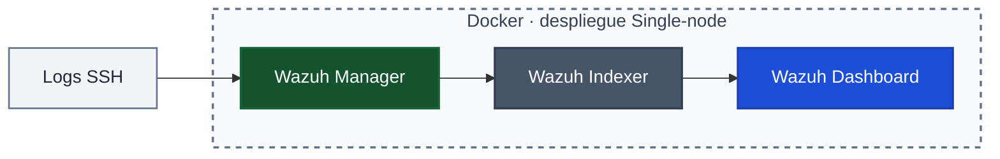

# Ruta de aprendizaje — Security Data Analyst

  

  

<!-- BANNER: Reemplazar con tu imagen -->

   

Programa introductorio de 90 sesiones para desarrollar criterio analítico aplicado al dominio de la seguridad. La prioridad es producir datos interpretables y evidencia reproducible, no operar un SOC.

## Perfil objetivo

- Security Data Analyst
- Junior Security Analyst orientado a datos
- Data Quality Analyst con enfoque en seguridad
- Security Reporting Analyst
- Junior GRC / Data Governance Analyst

### Perfil híbrido del programa

El radar representa de forma **ilustrativa** los cinco perfiles objetivo del programa; no son puntuaciones de aptitud ni resultados de evaluación.

## Alcance y no-alcance

> [!IMPORTANT]
> Este es un programa **INTRODUCTORIO**. No garantiza empleabilidad, no sustituye experiencia real en un SOC y no equivale a una certificación profesional. Tampoco forma administradores de infraestructura ni especialistas de pentesting.

El dato es el objetivo; la seguridad es el dominio de aplicación. Las prácticas usan datos sintéticos, públicos o expresamente autorizados. Cada sesión relacionada con seguridad debe terminar en una evidencia de datos: consulta, tabla, dashboard o informe. No se pide producir reglas operativas, playbooks ni respuestas a incidentes.

## Cómo empezar

1. Clona el repositorio: `git clone https://github.com/Jchernand3z19/security-data-analyst-learning-path.git`
2. Entra en la carpeta: `cd security-data-analyst-learning-path`
3. Lee la guía de [Fase 0](phases/phase-00-foundations/README.md) y realiza el diagnóstico inicial.
4. Abre el [plan detallado](curriculum/session-plan.md) y registra evidencia únicamente después de realizar la práctica.

## Estado del trabajo

**Sprint 1: CERRADO Y APROBADO. Sprint 2: CERRADO — documentación y evaluación actualizadas; Wazuh 4.9.0 validado físicamente con ingesta real de un log SSH sintético. Sprint 3: CERRADO Y APROBADO.**

### Decisión SIEM de Fase 4

- **Wazuh 4.9.0 Single-node:** seleccionado y validado en Docker Desktop sobre macOS Apple Silicon.
- Docker Desktop: 11.72 GiB asignados.
- Consumo aproximado: 2.9 GB (Indexer 1.66 GB, Manager 911 MB, Dashboard 382 MB); CPU inferior al 4%.
- Prueba: log sintético de fallo SSH; regla 5710, nivel 5; mapeo MITRE ATT&CK T1110.001 — Password Guessing.
- **ELK:** pendiente / descartado por recursos para este entorno y alcance. No se realizó benchmark equivalente, por lo que no se atribuye un consumo medido a ELK.
- Tiempo exacto de instalación Wazuh: no registrado.

Consulta el [checklist de validación](templates/lab-validation-checklist.md) y la [guía de Fase 4](phases/phase-04-siem-logs/README.md).

## Semana base — 7 días

| Día | Tipo | Actividad |
|---|---|---|
| Lunes | Normal | Sesión regular (90 min) |
| Martes | Normal | Sesión regular (90 min) |
| Miércoles | Laboratorio o normal | Laboratorio si la fase lo tiene; reemplaza la sesión normal, no se suma |
| Jueves | Normal | Sesión regular (90 min) |
| Viernes | **Libre — no tocar** | Descanso |
| Sábado | Repaso | Consolidación (45–60 min), no añade sesión |
| Domingo | **Libre — no tocar** | Descanso |

**Horario del bloque diario de estudio: 08:00 - 09:30 AM (America/Tegucigalpa).** Cada semana contiene cuatro bloques de avance de lunes a jueves. Nunca se programan dos laboratorios seguidos; en Fase 4, máximo dos laboratorios por semana. Los días libres no se utilizan para recuperar ni adelantar contenido.

## Dashboard de actividad del repositorio

  

El SVG se actualiza diariamente mediante GitHub Actions a partir de la actividad de este repositorio.

## Arquitectura de Wazuh en Docker

> [!NOTE]
> Este repositorio utiliza diagramas Mermaid dinámicos: GitHub interpreta el código Mermaid y renderiza los diagramas directamente en la página, incluidos sus estilos y colores.

La secuencia representa el flujo validado para el entorno Wazuh 4.9.0 Single-node: los eventos SSH llegan al Manager, se procesan y pasan al Indexer; el Dashboard consulta los datos indexados.

## Roadmap visual — Fase 0 a Fase 5

```mermaid
flowchart LR
    P0[Fase 0<br/>Fundamentos] --> P1[Fase 1<br/>Redes, HTTP y SQL]
    P1 --> P2[Fase 2<br/>Python, APIs y calidad]
    P2 --> P3[Fase 3<br/>Power BI y analítica]
    P3 --> P4[Fase 4<br/>Logs y seguridad]
    P4 --> P5[Fase 5<br/>Gobierno y proyecto final]
    classDef phase0 fill:#e2e8f0,stroke:#64748b,color:#1e293b,stroke-width:2px;
    classDef phase1 fill:#dbeafe,stroke:#2563eb,color:#1e3a8a,stroke-width:2px;
    classDef phase2 fill:#dcfce7,stroke:#16a34a,color:#14532d,stroke-width:2px;
    classDef phase3 fill:#fef3c7,stroke:#d97706,color:#78350f,stroke-width:2px;
    classDef phase4 fill:#ede9fe,stroke:#7c3aed,color:#4c1d95,stroke-width:2px;
    classDef phase5 fill:#fce7f3,stroke:#db2777,color:#831843,stroke-width:2px;
    class P0 phase0;
    class P1 phase1;
    class P2 phase2;
    class P3 phase3;
    class P4 phase4;
    class P5 phase5;
```

## Duración estimada por fase

| Fase | Sesiones | Estimación |
|---|---:|---:|
| 1 | 18 | 4.5 semanas |
| 2 | 18 | 4.5 semanas |
| 3 | 16 | 4 semanas |
| 4 | 18 | 4.5 semanas |
| 5 | 20 | 5 semanas |
| **Total** | **90** | **22.5 semanas** |

## Instalación y tiempo de estudio

> [!TIP]
> Antes de cada sesión de laboratorio, inicia Docker Desktop y comprueba que el motor esté funcionando. **Aviso al inicio de cada fase:** Día 1 incluye instalación (~1 h extra), el resto no. En Fase 4, Wazuh 4.9.0 ya está instalado y validado en el entorno descrito; no repetir instalación salvo que el laboratorio se reconstruya.

**Horario del bloque de estudio: 08:00 - 09:30 AM.** Los 90 minutos son el bloque de aprendizaje, no la jornada completa: 10 min recuperación, 20 explicación, 35 práctica guiada, 15 ejercicio individual y 10 evidencia/reflexión. El repaso de sábado dura 45–60 minutos.

## Coste y herramientas

Se priorizan herramientas gratuitas y open-source. Wazuh 4.9.0 es la plataforma SIEM seleccionada para la Fase 4. ELK no se instaló ni se sometió a benchmark equivalente; queda pendiente/descartado por recursos para este entorno y alcance.

## Ruta de las 90 sesiones

| Fase | Días | Enfoque |
|---|---:|---|
| 1 | 1–18 | Redes, HTTP, SQL y fundamentos de seguridad |
| 2 | 19–36 | Python, APIs y calidad de datos |
| 3 | 37–52 | Power BI y analítica segura |
| 4 | 53–70 | Logs y análisis de datos de seguridad |
| 5 | 71–90 | Gobierno, privacidad y proyecto final |

## Evaluaciones y control

Cada fase tiene quiz y debugging. La Fase 4 tiene una evaluación adaptada al caso real de Wazuh: 10 preguntas y 1 ejercicio de debugging. La rúbrica común se aplica a las evidencias de todas las fases.

## Checklist de aceptación — Sprint 2

- [x] Wazuh 4.9.0 Single-node instalado y validado en Docker Desktop/macOS Apple Silicon.
- [x] Registrar recursos reales y resultado de ingesta: ~2.9 GB RAM, CPU <4%, regla 5710/nivel 5 y MITRE T1110.001.
- [x] Mantener ELK como pendiente / descartado por recursos, sin afirmar benchmark no realizado.
- [x] Integrar el caso SSH en sesiones ATT&CK y SIEM, con campos `srcip`, `srcuser` y `rule.mitre.id`.
- [x] Publicar quiz Fase 4 de 10 preguntas y un ejercicio de debugging.
- [x] Aplicar la rúbrica común a la evidencia de Fase 4 y mantener la rúbrica de todas las fases.
- [x] Sprint 3 cerrado y aprobado; documentación de soporte y mantenimiento publicada.

**Nota:** el tiempo exacto de instalación de Wazuh no fue registrado; queda como dato no disponible, no como criterio que se haya medido.

## Prerrequisitos de Hardware y SO

- **RAM:** mínimo 8 GB; recomendado 16 GB para ejecutar Wazuh con fluidez.
- **Disco:** 50 GB libres como mínimo.
- **Sistema operativo:** macOS (Apple Silicon o Intel), Windows 10/11 con WSL2, o Linux.
- **Software base:** Docker Desktop instalado y funcionando.

Los requisitos son una referencia de preparación; la compatibilidad de cada herramienta también depende de su versión y arquitectura.

Consulta el [checklist de laboratorio](templates/lab-validation-checklist.md).

## Capturas

<!-- DIAGRAMA: Reemplazar con tu diagrama de draw.io/Excalidraw -->

<!-- Aquí va la captura del Dashboard de Wazuh -->

<!-- Aquí va la captura de la terminal -->

## Documentación de soporte

- [Glosario de datos y seguridad](docs/glossary.md)
- [Mapa de dependencias y exenciones por diagnóstico](docs/dependency-map.md)
- [Política de datos sintéticos](docs/data-synthetic-policy.md)
- [Mantenimiento del repositorio](MAINTENANCE.md)
- [Guía de uso diario y sincronización con Google Calendar](docs/how-to-use.md)
- [Progreso personal de las 90 sesiones](PROGRESS.md)
- [AUDIT-REPORT.md — informe de auditoría](AUDIT-REPORT.md)
- [Licencia MIT](LICENSE)

## Navegación

- [Plan detallado de las 90 sesiones](curriculum/session-plan.md)
- [Tracker](tracker.md)
- [Rúbrica de evidencias](templates/rubric-template.md)
- [Evaluaciones por fase](assessments/README.md)
- [Checklist de validación de laboratorios](templates/lab-validation-checklist.md)
- [Laboratorios](labs/README.md)
- [Guías por fase](phases/)

## Seguridad y uso responsable

Usa datos sintéticos, públicos o autorizados. No subas contraseñas, tokens, claves API, datos personales ni información confidencial. No ejecutes pruebas contra sistemas de terceros. Diferencia los resultados realmente obtenidos de los ejemplos y de las tareas pendientes.

**No formas analistas de SOC. Formas analistas de datos que entienden el dominio de la seguridad.**