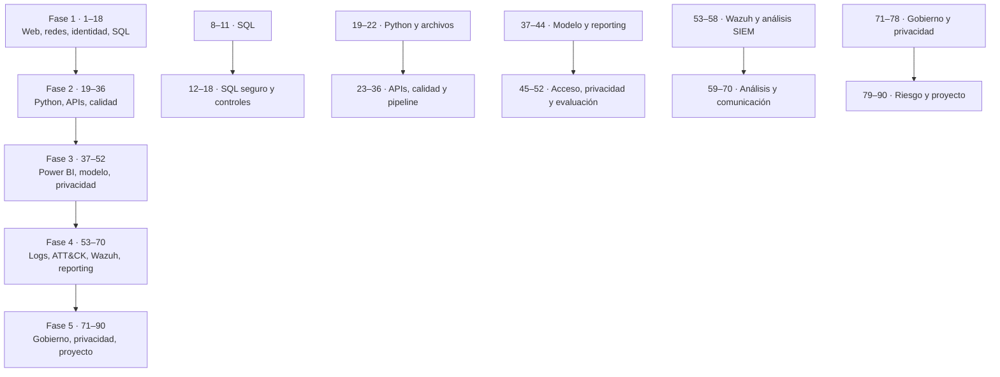

# Mapa de dependencias — 90 sesiones

Este mapa documenta prerrequisitos conceptuales y oportunidades de exención. **No cambia el orden, la duración ni la semana base del currículo.** Una sesión exenta por diagnóstico no se marca como completada automáticamente: registra el resultado de la prueba.

## Ruta general

## Dependencias por bloque

| Bloque | Prerrequisito recomendado | Habilita |
|---|---|---|
| 1–7: web, redes e identidad | Ninguno; punto de entrada | Interpretación de solicitudes, identidades y telemetría |
| 8–11: SQL relacional | Tablas, filas y claves; sesión 8 prepara 9–11 | Consultas, joins y agregaciones |
| 12–18: SQL seguro y controles | Fundamentos SQL de 8–11 | Consultas parametrizadas, validación, privilegios y auditoría |
| 19–22: Python y datos | Fundamentos de programación | Lectura, limpieza y transformación |
| 23–29: APIs y errores | Python básico 19–22 y HTTP 1–2 | Ingesta responsable y manejo de respuestas |
| 30–36: linaje, calidad y pipeline | CSV/JSON, funciones, errores y validación 19–29 | Pipeline reproducible |
| 37–44: modelo y reporting | Tablas, claves y agregación SQL 8–11; conceptos de datos de Fase 2 | Modelo dimensional y dashboards |
| 45–52: seguridad y evaluación BI | Modelo y reporte 37–44 | Acceso, RLS, clasificación y privacidad |
| 53–58: ATT&CK y SIEM | Logs/JSON 6, 16, 21, 27; calidad 22/32; lectura de métricas | Consulta y reporting de alertas Wazuh |
| 59–70: análisis de eventos | Consultas/campos 53–58; agregación y fechas | Análisis temporal, calidad y comunicación |
| 71–78: gobierno y privacidad | Catálogo, linaje y clasificación 47–50, 72–74 | Gobierno de datos y controles |
| 79–90: riesgo y proyecto | Evidencias de fases 2–4 y gobierno 71–78 | Proyecto final, auditoría y presentación |

## Sesiones que pueden eximirse con diagnóstico

Exime solo si el estudiante demuestra la habilidad en una prueba breve con datos nuevos, sin consultar soluciones. Si falla, completa la sesión normal.

| Sesiones candidatas | Cuándo se pueden saltar | Diagnóstico mínimo | No eximir |
|---|---|---|---|
| 8–11 (SQL básico) | Ya domina SQL relacional | Explicar claves y granularidad; resolver SELECT/WHERE, INNER/LEFT JOIN, GROUP BY/HAVING y validar resultados en dataset nuevo | 12–18: SQL seguro, validación, privilegios y auditoría |
| 19–22 (Python inicial y limpieza) | Ya programa en Python y perfila archivos | Leer CSV/JSON, escribir función, manejar error, detectar nulos/duplicados y entregar script reproducible | 23–36: APIs, secretos, esquemas, logging, pruebas, linaje y pipeline, salvo diagnóstico independiente |
| 37–44 (modelado y reporting) | Ya construye modelos y reportes Power BI | Explicar granularidad/cardinalidad, crear medida DAX, reconciliar indicador y entregar reporte filtrable | 45–52: RLS, permisos, clasificación, privacidad, accesibilidad y evaluación |
| 53–56 (fundamentos SIEM) | Tiene experiencia demostrable consultando alertas en un SIEM | Localizar alerta, filtrar regla, extraer campos, interpretar rule.mitre.id y distinguir evento/alerta/incidente | 57–58: calidad y dashboard de reporting; 59–70 si no demuestra esas competencias |
| 71–75 (fundamentos de gobierno) | Ya mantiene inventario, catálogo, linaje y reglas de calidad | Entregar inventario, catálogo, diagrama de linaje y reglas medibles | 76–90: privacidad, retención, accesos, riesgos y proyecto |

No se recomienda eximir 1–7, 12–18, 25, 27, 35, 45–52, 57–58, 68–69 ni 76–90 solo por experiencia laboral: contienen controles, privacidad, límites de conclusión o evidencias específicas del perfil híbrido.

## Reglas de uso
1. Haz el diagnóstico antes de marcar una exención.
2. Guarda la prueba y su resultado en PROGRESS.md o en una carpeta de evidencias.
3. Registra “exento por diagnóstico”, no “completado”.
4. Mantén las sesiones no eximidas en el orden original y conserva la semana base.
5. La puerta de instalación/compatibilidad de Power BI del plan sigue siendo obligatoria aunque se eximan sesiones de contenido.
6. La validación de Wazuh no completa las sesiones 53–58: el estudiante aún debe producir sus propias consultas y evidencias.
