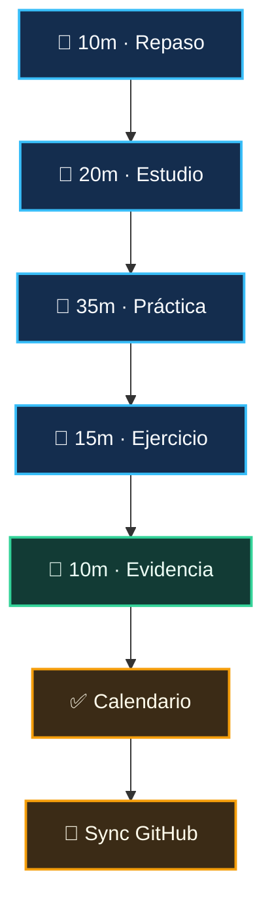

# Flujo diario de estudio

A las **08:00 AM**, abre el evento del día en Google Calendar y revisa el objetivo, los recursos y la evidencia esperada. Completa el bloque de 90 minutos siguiendo los cinco pasos: **10 min recuperación activa → 20 min estudio → 35 min práctica guiada → 15 min ejercicio individual → 10 min evidencia y dudas**.

Al terminar la práctica y guardar la evidencia, antepone **✅** al título del evento (por ejemplo: `✅ Día 01 — Explicar cliente, servidor y ciclo HTTP`). El workflow consulta los eventos del día a las **23:55 hora de Honduras** y marca la sesión correspondiente como `[x]` en `tracker.md`; no modifica el currículo ni marca sesiones sin el marcador del evento.

