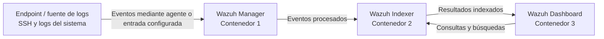

# Laboratorio — Perfilado analítico de logs sintéticos

**Fase:** 4 — Logs y análisis de datos de seguridad.

## Objetivo

Convertir registros sintéticos en tablas de análisis y métricas de calidad. Este laboratorio no genera alertas, no implementa reglas de detección y no ejecuta respuesta operativa.

## Arquitectura del laboratorio Wazuh 4.9.0

El diagrama representa el flujo lógico de ingesta y consulta de la instalación Single-node validada. Los logs del endpoint llegan al Wazuh Manager; el Manager procesa los eventos y los envía al Wazuh Indexer; el Dashboard consulta el Indexer para visualizarlos.



## Ejecución local

Desde la raíz del repositorio:

```bash
python3 labs/phase-04-log-analysis/analyze_auth_logs.py
```

El script lee sample_auth_events.csv y genera:
- output/valid_events.csv
- output/event_summary.csv
- output/quality_report.json

## Resultado esperado con el CSV incluido

- 9 filas de entrada.
- 7 eventos válidos.
- 2 filas rechazadas: un request_id duplicado (R-005) y un timestamp inválido.
- La tabla resumen muestra conteos por event_type y outcome.
- El informe conserva el motivo de cada rechazo.

Si el resultado difiere, revisa versión del archivo y ejecución. Estos valores son esperados por inspección del CSV; no se afirma que el script haya sido ejecutado en el equipo del usuario.

## Sesiones y evidencias
- ATT&CK como vocabulario descriptivo: [attack-context.md](attack-context.md).
- Ticket de contexto triage: [triage-data-template.md](triage-data-template.md).
- La selección SIEM y su ingesta real siguen pendientes hasta completar [checklist](../../templates/lab-validation-checklist.md).

## Preguntas analíticas
1. ¿Qué proporción de filas quedó válida? Indica numerador y denominador.
2. ¿Qué campo concentra el rechazo y por qué?
3. ¿Cómo cambiaría el conteo si no se deduplicara request_id?
4. ¿Qué contexto faltaría para interpretar los fallos de autenticación?
5. ¿Por qué estos conteos no prueban un incidente?

